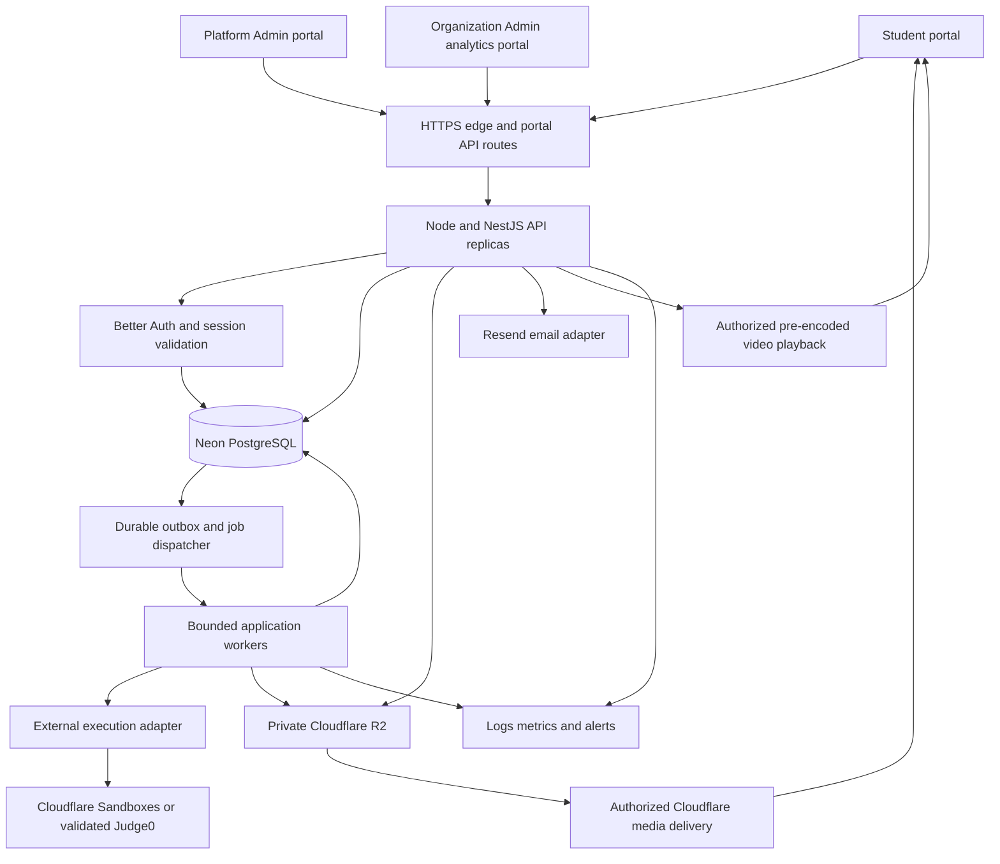
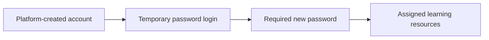

# OTP Slate Production Architecture

Build three separately deployed portals backed by a modular application API, PostgreSQL, background workers, private file storage, and an external code execution service. Platform Admin owns provisioning and enrollment. Organization Admin receives only analytics for the organization assigned to its account. Students receive only the resources Platform Admin assigns.

This architecture translates the existing HTML workflows into production services. It incorporates the confirmed product decisions and the user's approval of the revised recommended stack; capacities, provider procurement and operating policies remain subject to the launch checks specified here. Updated on 6 October 2026. This document is a plan, not a deployed backend.

Application conversion has started. See the [application setup and implementation status](application-setup.md) for working routes, local accounts, commands and remaining release work. Planned capabilities below should not be read as a claim that they are all implemented.

The [production stack review](stack-options-review.md) explains the accepted choices and their tradeoffs. This document is the current implementation baseline: React/React Router, Node/NestJS, Neon/Drizzle, Better Auth with revocable sessions and JWT where required, Resend and private Cloudflare R2. Cloudflare Sandboxes will be benchmarked against managed Judge0 before choosing exam execution. The background-job provider is undecided, and job listings will be added manually by Platform Admin.

## Confirmed launch requirements

| Decision | Agreed behavior |
| --- | --- |
| Student population | 2,000 registered students; simultaneous usage has not been specified |
| Operating budget | ₹20,000 per month, including hosting, execution, email and recorded-video delivery |
| Provisioning | Platform Admin creates student accounts and temporary passwords; organizations distribute credentials outside the read-only portal |
| First student login | Change the temporary password before accessing assigned learning resources |
| Live exams | Timed exams with browser monitoring |
| Learning delivery | Recorded courses plus live classes through an existing Zoom or Google Meet account |
| Web development and Full Stack | Submit project and repository links |
| Organization members | Platform Admin can create multiple individual viewer accounts for each organization; organization membership is fixed for each viewer |

The engineering starting point is 200 simultaneous learners and a 300-student exam cohort, subject to load testing. These are proposed sizing assumptions, not a reinterpretation of the registered-student requirement.

## Product boundaries

| Portal | Production responsibilities | Access boundary |
| --- | --- | --- |
| Student | Assigned courses and modules; CRT; practice; live exams; personal progress and rankings; jobs; resume builder | Own account and submissions, assigned resources, published jobs, and permitted organization rankings |
| Platform Admin | Organizations; student and viewer accounts; Excel imports; cohorts; access profiles and individual assignments; course content; problem and question banks; exams; jobs; audit and operational reports | Explicit platform privileges, with an organization scope recorded for every organization-specific change |
| Organization Admin | Participation, course progress, skills, practice and exam analytics, student performance and individual student insights | Fixed organization from the authenticated account; analytics only |

Organization members do not create organizations, manage students, enroll learners, change learning access, publish exams, edit jobs, or manage other member accounts. Their authentication actions, such as signing in, changing their own password, and signing out, remain available. Every member email has its own identity; there is no shared organization password.

The course catalog contains C, C++, Python, Java, Advanced DSA, Full Stack Development and Competitive Coding. CRT has its own navigation entry for the shared curriculum; Hiring Assessments are available through Practice. Practice collects eligible practice activities; Live Exams displays exams released by Platform Admin and an empty state when none are available. Calendar, to-do and recent feedback are outside the agreed student UI.

| Catalog group | Required content |
| --- | --- |
| Hiring Assessments | Aptitude, typing, programming/problem-solving and web-development practice; links to eligible live tests |
| CRT Modules | Competitive aptitude, logical reasoning, competitive programming and interview skills |
| Advanced DSA | Data structures and algorithms, with versioned lessons and problem sets |
| Full Stack Development | MERN, Java and Python tracks with repository/project submissions |
| Competitive Coding | Language-specific problem collections, targeting 100 problems each for C++, Java, Python and other enabled languages |

Collections reference reusable problems and their validated runtimes; the same problem need not be copied into every collection. Show actual published counts, rather than claiming 100 available problems before that content exists. Assigned courses remain available through Courses, and eligible practice activities through Practice.

Full Stack combines courses with repository/project-link submissions. Live classes open authorized Zoom or Google Meet links. Browser monitoring records exam-related browser signals; webcam recording, browser-hosted full applications, AI assistance, billing and public self-registration are outside the launch scope.

## Accepted implementation stack

| Layer | Accepted direction | Reason for this product |
| --- | --- | --- |
| Three frontends | React, TypeScript, Vite, React Router and TanStack Query | Separate authenticated applications with shared UI components, independent routing and predictable server data handling |
| Design system | Shared tokens and components derived from the current Lato, navy, yellow and slate UI | Preserve the approved appearance while allowing different layouts for students, management and analytics |
| Backend | NestJS on Node.js 24 LTS, REST API with OpenAPI | One TypeScript codebase with modules for the domain rules and API contracts |
| Database | Neon PostgreSQL, Drizzle and SQL migrations | Transactions, relational constraints, versioned assessment data and organization isolation; Free for development, Launch budgeted for the pilot |
| Background processing | Durable PostgreSQL outbox and job records; queue provider deferred | Imports, provisioning, grading orchestration, analytics and PDF generation need retries and bounded workers; no Redis subscription is assumed |
| Authentication | Better Auth on Node.js with database-backed sessions; short-lived JWT where needed | Maintained password/session handling; application membership, onboarding and learning permissions remain server-owned |
| Account email | Resend | Password-reset transport and operational messages; quota-aware delivery |
| Code execution | Cloudflare Sandboxes/Containers trial, compared with managed Judge0 through a common adapter | Student compilation stays outside the LMS API and database; exam use is gated on correctness, isolation, recovery, throughput and cost |
| Content and uploads | Private Cloudflare R2, with pre-encoded course video at launch | Low storage cost and free direct egress; the LMS owns its player, authorized delivery and rendition preparation |
| Charts and editor | Accessible chart components and a focused code editor component | Retain the problem description, editor and test-result layout already approved |
| Deployment | Cloudflare static frontends; containerized Node API/workers on a modest host, with DigitalOcean as the budget reference | Independent portal releases and standard Node support; Cloudflare Workers handles media/execution integration rather than replacing NestJS |

React documents the Vite, routing and query-library approach for applications built from scratch. This choice fits authenticated portals that do not require public-page SEO. [React application guidance](https://react.dev/learn/build-a-react-app-from-scratch)

Pin supported dependency versions during implementation and update them through CI. Node.js 24 is currently an LTS release; the Node project recommends LTS releases for production. [Node.js release status](https://nodejs.org/en/about/previous-releases)

Start with a modular monolith: one backend codebase and database, with separate API and worker processes. Split services later when measurements identify a scaling or ownership boundary. The external execution service is isolated from the outset because it runs student code.

NestJS is a backend framework running on Node.js; it is distinct from Next.js, which is not required for these portals. Prisma ORM is an alternative database library, rather than an alternative to Neon hosting. Drizzle is the selected query layer. Hosting the entire API on Workers with Hono would be a future architecture change, not an assumption that NestJS runs unchanged there.

## System layout



Use separate hosts such as `learn.example.com`, `admin.example.com` and `insights.example.com`. Each host serves its own frontend and forwards `/api/*` to the shared API deployment. These are proposed domain names, not existing deployments.

Each portal has a host-specific session cookie and an allowed application context. Student or viewer sessions cannot call platform management routes, even if someone copies an admin URL. Management screens and code are not included in the organization frontend bundle.

Authenticated responses are never cached publicly at the CDN. Cache only static assets and explicitly authorized content delivery. API clients receive filtered resources and response fields, rather than downloading the entire workspace and filtering it in JavaScript.

## Backend modules

| Module | Owns | Important production behavior |
| --- | --- | --- |
| Identity and sessions | Provisioning, authentication adapter, active sessions, password resets and MFA flows | No public registration; active membership required after authentication |
| Organizations | Organization status and member accounts | Archive preserves history and stops access; any number of distinct viewer accounts within operational capacity |
| Students and cohorts | Student roster, cohort membership and imports | Only Platform Admin edits records; tenant constraints apply to every relationship |
| Catalog and content | Course, module, lesson and asset versions | Draft and publish workflows; assigned version controls what a student can open |
| Learning access | Profiles, grants, expiry and individual overrides | Default deny; server checks resource access on every request |
| Practice and questions | MCQs, coding problems, typing passages, SQL exercises and project rubrics | Validated content, language drivers, grading rules and hidden tests |
| Assessments | Exam publication, audiences, attempts, answers and results | Server deadlines, autosave revisions, idempotent submission and controlled result release |
| Execution orchestration | Logical coding submissions and provider jobs | Rate limits, fair queues, retries and trusted grading results |
| Progress and analytics | Learning events, completion and organization summaries | Rebuildable aggregates from durable source records |
| Career tools | Published jobs, personal resumes, templates and exports | Original application links; students edit only their own resume |
| Audit and operations | Administrative changes, incidents and support actions | Traceable changes without credentials or unrestricted student code in logs |

The processing contract must tolerate retries regardless of the eventual queue library. Persist job type, organization scope, idempotency key, attempt count, availability time, lease expiry, status and bounded error metadata in PostgreSQL. Use atomic claims, expiring leases, capped backoff and operator-visible exhausted jobs. A simple bounded worker can consume those records initially; selecting BullMQ, a PostgreSQL queue library or another service is deferred. No automatic job-listing discovery is part of this work.

## Authentication and authorization

### Account provisioning

Platform Admin creates an organization, creates its student and viewer records, and requests Better Auth identities through a bounded provisioning worker. Accounts progress through `pending`, `active`, `suspended` or `disabled` states. An authenticated identity alone never grants application access. The credential tables belong to the authentication layer and are linked to application accounts by a unique identity ID.

Generate a unique random temporary password for each student and organization member. Platform Admin receives an expiring credential distribution file once; the organization distributes student credentials through its existing channel. The organization analytics portal never receives credential-management screens or APIs. Store any short-lived distribution artifact encrypted, audit its download and delete it after the distribution window. Do not keep permanent passwords or plaintext credentials in logs, import history or analytics.

Require organization members to change their temporary password on first sign-in. Platform Admin can reset or disable an account but cannot retrieve its permanent password. Use a protected server-side provisioning adapter, disable public sign-up, and send no automatic invitations because distribution is handled by the organization. Passwords are hashed through Better Auth's maintained password implementation; do not implement password hashing with JWT. Verify disable-sign-up and provisioning behavior together during integration. [Better Auth email/password configuration](https://better-auth.com/docs/authentication/email-password)

Require MFA for Platform Admin through Better Auth's two-factor support and application guards. Student and organization sessions use their own trusted portal context and server-enforced roles. Platform privileges cannot be assigned through public authentication payloads. Student password setup is separate from administrator MFA. [Better Auth two-factor support](https://better-auth.com/docs/plugins/2fa)

### First student login

Use the provisioned email and temporary password for the initial login. Better Auth verifies credentials; application guards restrict the session until the student replaces the temporary password. After password setup, the student can open only assigned courses and enabled features. Phone numbers are contact details and never gate account access.



Persist `password_setup_complete` separately from suspension and organization access. Students who previously stopped at phone setup proceed once password setup is complete. Retired phone challenge endpoints are unavailable. Historical verification records do not grant or deny access.

Forgotten passwords use Better Auth's expiring reset links delivered by Resend. Resetting a password revokes sessions and does not clear suspension or change course access. Keep student welcome emails and reset-email failures visible and retryable.

### Sessions

Use Better Auth's database-backed sessions in `Secure`, `HttpOnly`, host-only cookies. Keep shared parent-domain cookies off. Apply SameSite settings appropriate to the portal flow, CSRF controls on mutations and trusted Origin checks; do not use cached session metadata to bypass a fresh suspension or role check. These controls follow OWASP session guidance. [OWASP session management](https://cheatsheetseries.owasp.org/cheatsheets/Session_Management_Cheat_Sheet.html)

Use the JWT plugin only for API/integration paths that need signed bearer tokens. Set a proposed five-minute expiry, validate issuer, audience, signature and expiry, and bind each token to a revocable server session and current account/access revision. Avoid long-lived JWTs in browser localStorage. The three web portals use cookie sessions by default. JWTs do not store passwords and do not replace the session system; revocation and onboarding checks are still required on every protected route. [Better Auth JWT plugin](https://better-auth.com/docs/plugins/jwt)

Every request checks session validity, portal context, account status, current membership and organization status. Logout revokes the application session and clears its cookie. Password reset, account disable and organization archive revoke relevant sessions and close active event streams. Never authorize a request using a user ID, role or organization ID supplied by the browser.

Proposed session defaults are an eight-hour absolute lifetime, 30-minute student/viewer inactivity timeout and 15-minute platform inactivity timeout. Active exam heartbeats count as activity. Validate that the maximum configured exam duration fits within the absolute lifetime, or require fresh login before starting. The API fails closed if it cannot verify access; it never falls back to demo users or seed data.

### Permission matrix

| Action | Platform Admin | Organization Admin | Student |
| --- | --- | --- | --- |
| Create organizations or provision accounts | Allowed | Denied | Denied |
| Edit students or cohort membership | Allowed | Denied | Denied |
| Assign courses, modules or practice | Allowed | Denied | Denied |
| Author content, publish exams or jobs | Allowed | Denied | Denied |
| Read organization analytics | Allowed for selected organization | Assigned organization only | Own progress and permitted ranking fields |
| Read student submission or score | Authorized platform scope | Approved performance fields in assigned organization | Own records |
| Edit a resume | No default right to edit a student's resume | Denied | Own resume only |
| Change password or sign out | Own identity | Own identity | Own identity |

Apply authorization through centralized guards plus resource-level checks, including downloads and exports. Organization analytics endpoints expose only approved fields; viewer accounts do not receive phone numbers, credential information, private resumes or hidden tests. [OWASP authorization guidance](https://cheatsheetseries.owasp.org/cheatsheets/Authorization_Cheat_Sheet.html)

### Organization isolation

Every organization-owned record has an `org_id`. The API obtains this context from the active membership and scopes queries accordingly. Use PostgreSQL row-level security as an additional boundary, with transaction-local context to avoid leakage through pooled connections. Runtime database roles must not own tables or have `BYPASSRLS`; use `FORCE ROW LEVEL SECURITY` where appropriate. Migration credentials stay separate. [PostgreSQL row security](https://www.postgresql.org/docs/current/ddl-rowsecurity.html)

Use a SELECT-only database role for organization analytics reads. Platform writes and worker writes use separate restricted roles. Composite foreign keys include `org_id`, so a student, cohort, profile or attempt cannot reference a parent from another organization. Global catalog resources are a deliberate exception: student access still requires an organization-scoped grant.

Test tenant boundaries in HTTP handlers, database policies, caches, job payloads, event streams and file authorization. A shared database is acceptable only with those enforced boundaries.

## Learning access semantics

Keep the behavior already established in the prototype:

1. New students start with no learning access.
2. Platform Admin assigns a reusable profile or an individual override.
3. An individual override replaces the profile selection; it does not silently add to it.
4. Cohorts select students for an explicit assignment operation. Joining a cohort does not automatically enroll a new student.
5. Suspended students, archived organizations and expired grants cannot access protected resources.
6. Publishing an exam creates a separate exam entitlement for its selected audience. General practice access does not grant entry to every live exam.

Store course grants against a published course version. “All modules” initially means all modules in that assigned version; newly published modules require an explicit upgrade or an explicitly configured follow-up policy. This prevents accidental enrollment when content expands. Use stable module and lesson IDs rather than the prototype's array positions. Retain explicit feature grants for Jobs, Resume and Rankings as well as course/practice grants; ownership or published audience does not bypass a disabled feature.

Maintain an access revision for each student. Changes invalidate resource caches and are recorded in the audit log. Recheck access for content reads, asset-link issuance, practice starts, exam starts and answer submissions. Existing signed asset links have a short validity window, proposed at 60 seconds; already downloaded content cannot be recalled.

## Production data model

Use UUIDs, UTC timestamps and explicit lifecycle states. Display times in the organization's configured timezone, initially Asia/Kolkata. Do not use client clocks as the authority for deadlines.

| Domain | Core tables | Relationships and constraints |
| --- | --- | --- |
| Identity | Better Auth credential/session/verification/JWKS tables in an auth namespace; application `accounts`, `platform_roles`, `org_memberships`, `provisioning_jobs`, `phone_challenges` | Unique authentication ID and normalized login email; initially one active organization membership per student or viewer; onboarding and role flags set by the server |
| Organizations | `organizations`, `student_profiles`, `cohorts`, `cohort_students` | Student ID unique per organization; organization included in parent-child foreign keys |
| Content | `courses`, `course_versions`, `modules`, `module_versions`, `lessons`, `lesson_versions`, `assets` | Published versions immutable; stable IDs preserve history across revisions |
| Live classes | `live_class_sessions`, `live_class_audience`, `class_join_events`, `attendance_records` | Course/cohort audience, external provider link, schedule and attendance evidence source |
| Access | `access_profiles`, `profile_versions`, `profile_grants`, `student_access_assignments`, `individual_grants` | Explicit grant types, resource versions, expiry, assignment revision and assigning admin |
| Questions | `questions`, `question_versions`, `coding_problems`, `test_cases`, `language_drivers`, `typing_passages`, `project_rubrics` | Versioned scoring; separate sample and hidden cases; expected answers restricted to grading services |
| Exams | `exams`, `exam_versions`, `exam_publications`, `exam_audience`, `attempts`, `attempt_questions`, `answers` | Audience snapshot; unique student and attempt number; pinned question version, order, language policy and deadline |
| Monitoring | `exam_monitoring_events`, `exam_reviews` | Idempotent event ID, attempt ownership, browser event time and server receipt time; review decision and actor |
| Coding | `submissions`, `execution_jobs`, `execution_case_results`, `grading_revisions` | Logical submission distinct from provider jobs; provider tokens mapped server-side; duplicate results cannot duplicate grades |
| Projects | `project_submissions`, `project_reviews` | Student owner, assignment/rubric version, repository reference, review revision and result release |
| Progress | `lesson_progress`, `practice_attempts`, `learning_events` | Server-recorded completion evidence; events carry organization, student, content and event IDs |
| Analytics | `student_daily_metrics`, `organization_daily_metrics`, `skill_metrics`, `exam_rankings` | Rebuildable aggregates, metric version and data freshness timestamp |
| Career | `job_posts`, `job_audiences`, `resumes`, `resume_versions`, `export_jobs` | Resume owner is the student; jobs published to organizations or selected cohorts |
| Operations | `import_batches`, `import_rows`, `audit_events`, `outbox_events` | Idempotency keys, file digest, row errors and immutable change records |

Index the actual query paths: organization and status for rosters; organization, student and date for activity; exam and student for attempts; attempt and question for answers; organization and period for analytics; submission and provider token for grading. Use pagination rather than retrieving entire rosters.

Neon PostgreSQL is authoritative for attempts, answers, grades, access, sessions and durable processing state. Choose a shared rate-limit/event mechanism during implementation; process-local counters alone cannot enforce limits across API replicas. The queue provider is undecided and no Redis cache is required for correctness. Private R2 holds uploads, course media and generated artifacts; source-code blobs may move there when size warrants it. Do not place hidden tests or credentials in frontend bundles.

## Provisioning and Excel imports

The import workflow is `upload → validate → preview → confirm → provision → report`. Use a versioned `.xlsx` template with `student_id`, `full_name`, `login_email`, `cohort_code`, optional `access_profile_code` and optional `access_expires_at`. Organization scope comes from the admin's selected organization. The template cannot grant platform or organization-viewer roles; provision viewers through their separate workflow.

Validate required fields, normalized email uniqueness, duplicate IDs, dates, existing accounts and organization-scoped cohort/profile references. Reject macros, formula cells in data columns, oversized archives and unsupported workbook versions. Limit uploads by compressed size, expanded size and row count. Imports do not evaluate spreadsheet formulas.

Preview creates no identities and grants no access. Confirmation checks the file digest, import revision and current organization state, then writes roster changes, explicit assignments and provisioning outbox entries in a transaction. Better Auth credential provisioning happens afterward through bounded workers with independent idempotency keys. Report row-level progress and retry only unresolved rows. Unique account and batch keys prevent duplicate accounts on retries; incomplete identities remain unable to sign in to the application.

Keep roster creation and access assignment explicit in the preview. Rows without a profile receive no learning access. Bulk changes record the admin, organization, selected students and before/after access revisions. A 2,000-student workbook is a required acceptance case, including repeated confirmation and partially failed provider provisioning.

## Courses, classes and project submissions

Platform Admin needs a content-authoring workflow in addition to the current catalog cards: draft course versions, modules, lessons, upload status, ordered content, published versions, assessments and completion rules. Add a question bank with tags for language, skill, difficulty, sample cases, hidden cases and rubrics. Publish only after validation; editing published material creates a new version.

Recorded videos upload to private R2 using short-lived, narrowly scoped upload authorization. For launch, the content team prepares supported MP4 or HLS renditions before upload; R2 does not encode videos automatically. Store the asset, rendition metadata and validation status; publish only after playback validation. Add offline/trusted encoding later if needed, with its processing cost included separately. Do not attempt video encoding in ordinary Workers. [R2 overview](https://developers.cloudflare.com/r2/)

The API checks enrollment and issues a short-lived playback authorization. A Cloudflare media Worker validates the authorization and streams approved private R2 objects, with tested range requests, content types and cache behavior. Validate MP4 seeking or every HLS playlist/segment request, rather than protecting only the player page. The media Worker receives no database administrator credentials. Define the short expiry/recheck behavior, test cached responses for unauthorized access and keep public bucket access off. Already downloaded content cannot be recalled. [Workers R2 API](https://developers.cloudflare.com/r2/api/workers/workers-api-reference/)

Platform Admin schedules live classes against a course or cohort, storing the existing Zoom/Meet meeting link, start/end time and joining window. Students see and open a class only if assigned. Organization viewers may see participation summaries but receive no class-management controls. Configure waiting rooms or participant restrictions in the existing conferencing account; a copied meeting link can otherwise bypass the LMS's access decision. [Zoom meeting controls](https://www.zoom.com/en/products/virtual-meetings/resources/securing-your-meetings/), [Google Meet waiting rooms](https://support.google.com/meet/answer/16523457?hl=en)

Confirm the existing account's participant, meeting-duration and recording limits before publishing class audiences. Google Meet capacity depends on the account edition; registered LMS student count is separate from meeting capacity. Split cohorts or adjust the conferencing license if needed, without building a new conferencing service. [Google Meet limits](https://support.google.com/meet/answer/7317473)

For launch, record an LMS join click as a join click, not confirmed attendance. Actual attendance comes from a reviewed provider report or a later authorized API integration. Keep attendance evidence and its source visible in analytics. Class recordings can be added as recorded lessons after the host supplies an authorized recording. Existing conferencing subscription fees are outside the new hosting estimate because the account is already owned.

Project submissions store a repository URL, optional deployed-project URL, notes, version/commit reference and submission time. Platform Admin reviews them against a rubric and releases feedback. Validate HTTPS links and render them safely. The LMS does not fetch or execute arbitrary repositories or application URLs automatically. Interview-skills work can use lessons, quizzes and rubric-reviewed submissions under the same content model.

Grade aptitude and reasoning answers on the server using immutable answer keys and point rules. For typing, persist the passage and timed attempt; calculate accuracy and correct-character WPM from the accepted final text using a documented normalization rule. Browser paste/keystroke signals may inform review but do not prove that a human typed the text. Project and interview rubrics require an authorized platform reviewer. Web previews provide feedback only; automated DOM/browser grading would need a separately trialed sandbox capability, rather than treating a working preview as a passing grade.

## Practice and external code execution

### Student experience and language support

Preserve the LeetCode-style problem layout: description and examples, a focused editor, language selector, Run, Submit and result panel. Do not embed a provider's IDE, file explorer or terminal interface.

Maintain a server-side runtime registry from validated compiler images or the contracted provider's catalog. Display only languages enabled by Platform Admin and validated for the selected problem. The product target includes C, C++, Python, Java, JavaScript, TypeScript, C#, Go, Rust, Kotlin, Ruby and PHP, subject to the chosen endpoint's capabilities. Validate the core C/C++/Python/Java drivers first, then publish the additional languages after the same tests. A provider's broad language list does not mean each problem already has a correct function signature, wrapper or grading driver in those languages.

Use either standardized stdin/stdout problems or versioned per-language function drivers. Pin runtime versions and scoring rules to each exam/problem version. Do not let students select arbitrary compiler flags, package installations, network access or machine resource limits.

### Provider choice

Benchmark Cloudflare Sandboxes/Containers as the first candidate and managed Judge0 as the comparison/fallback candidate. Keep both behind one execution adapter; select the provider before admitting real exam candidates. Switching providers is an audited operational decision, not a silent mid-attempt fallback. Judge0 supplies a judge engine and runtime catalog; a Cloudflare implementation requires us to build language images, drivers and the grading orchestration. [Cloudflare Sandboxes](https://developers.cloudflare.com/sandbox/), [Judge0](https://judge0.com/), [Judge0 API](https://ce.judge0.com/)

Ordinary Workers are not a native compiler host. Use Containers for installed C/C++/Java/Python toolchains; Dynamic Workers can be trialed separately for JavaScript, Python and WebAssembly. Container scheduling is in public beta. A trusted control Worker accepts requests only from the LMS execution adapter, derives sandbox IDs server-side, starts isolated environments, collects bounded outputs and shuts them down. Student code receives no LMS credentials or expected hidden outputs. Match runtime outputs against expected answers in trusted orchestration. Test process termination, cleanup and cross-submission isolation. [Sandbox security](https://developers.cloudflare.com/sandbox/concepts/security/), [Workers Node compatibility](https://developers.cloudflare.com/workers/runtime-apis/nodejs/)

Piston remains an open-source alternative, but its public API now requires approval and is restricted to qualifying non-commercial educational projects. It is not a dependable free production allocation for this LMS. Self-hosting either engine would move compilation onto infrastructure we operate, contrary to the requested offloading. [Piston public API policy](https://github.com/engineer-man/piston#public-api)

The trial covers accepted, wrong-answer, compiler-error, timeout, memory-limit, oversized-output, networking and malicious-process cases in every core language. Rehearse a 300-student exam burst with cold environments, retries and delayed grading. Measure real cost per logical submission, including hidden cases, startup/idle time, Workers, Durable Objects, logs and container resource usage. Validate provider data handling and retention. Do not treat a large HTTP request allowance as compiler capacity or silently fall back to an unauthenticated public endpoint.

### Submission pipeline

1. API checks student status, onboarding, entitlement, problem version, permitted runtime and execution quota.
2. Write an immutable logical submission and outbox entry together in PostgreSQL; respond `202 Accepted` with an LMS submission ID.
3. Dispatcher claims or queues orchestration work through the chosen durable processing mechanism. Workers submit bounded provider jobs and persist execution identifiers before polling for completion.
4. Workers obtain authoritative provider results, apply the versioned scoring policy and commit case results, grade and learning event transactionally.
5. Send status to the student through an authorized event stream or bounded polling while work is pending.

The adapter exposes capabilities, submit, result retrieval, status normalization and optional cancellation. Keep provider keys and tokens server-side. A provider callback is a completion notification: validate its binding to our job and retrieve the authoritative result through the authenticated provider API before grading. Never accept a browser-supplied verdict as a grade.

Use per-student cooldowns, fair organization scheduling, global provider rate limits and reserved live-exam capacity. Run normally evaluates sample/custom inputs; Submit evaluates the hidden set. Pin maximum test counts and include retries in the budget. Judge0 may bill each case as a submission; Cloudflare bills resources consumed while environments run. Batch requests do not imply a single billed execution, and combining cases never bypasses per-case limits or isolation requirements.

Configure CPU, wall-time, memory, process and output limits by validated runtime. Disable outbound network access in execution. Escape and truncate stdout, stderr and compiler messages before display. Give providers pseudonymous submission IDs and code, not student names, emails or phone numbers. Hidden inputs, expected outputs and detailed hidden-case logs stay out of student responses; feedback policy determines whether students see only the verdict or aggregate passed-case counts.

Do not execute student JavaScript through `new Function` in the authenticated page. HTML preview, if retained for small exercises, runs on a separate unprivileged origin in a sandbox without LMS cookies. SQL exercises run against disposable exercise data in the external sandbox, never against the production database. Full Stack remains link submission and review.

Persist job transitions and use unique submission/case/grading-version keys to make retries safe. After a submission request times out ambiguously, reconcile the provider job before retrying; if reconciliation is impossible, record an indeterminate execution for controlled recovery. Worker failure or provider failure must not become a student wrong answer. Display queued or grading-delayed status, retry with limits and route exhausted jobs to an operator review queue.

## Timed exams and browser monitoring

### Publication and admission

Platform Admin creates a draft exam, selects validated question versions, duration, opening/closing times, audience, languages and grading rules, then previews and publishes it. Publication freezes the audience and rules. An edit after publication requires a new version or an explicit audited correction; attempts retain their original version.

Use `scheduled → open → closed → grading → results_released`, with a separate cancellation state. A student's attempt progresses through `in_progress → submitted → grading → graded`, with voiding available only through an audited platform action. The student-facing Live Exams page is derived from publication and entitlement, including the no-exam empty state.

Proposed launch defaults: one attempt per live exam; no negative marking; closing time is a hard stop; results are released by Platform Admin after grading. A late starter receives only the remaining window. Practice attempts are repeatable within execution quotas. These defaults must be visible in the exam setup screen.

### Durable answers and deadlines

The API computes `deadline = min(started_at + duration, closes_at)` and returns server time. Browser countdowns are display only. Starting an exam twice returns the existing permitted attempt rather than creating two attempts.

Autosave changed answers with a proposed two-second debounce and ten-second maximum interval, with jitter across clients. Each answer carries an expected revision and idempotency key. The server locks/checks the attempt, verifies admission and deadline, then commits the answer; only a committed save receives a saved acknowledgement. Reject stale revisions with a recoverable conflict response. Show pending, saved and reconnecting states to the student.

Manual submission and deadline finalization lock the attempt and freeze its last server-accepted answers. Final coding grades use that frozen code, runtime and test version. Reuse an earlier completed evaluation only when the full grading inputs match; otherwise queue final evaluation. Provider completion after the deadline is valid when the code was accepted before it. Unacknowledged local changes are not treated as saved answers, and the UI must make this visible.

A sweeper finalizes expired attempts even if the student closes the tab. A queue or dispatcher failure cannot erase answers or reset time. Preserve accepted work during an incident; any reopening, extra time or regrade is an explicit audited platform decision. Revoking eligibility blocks subsequent access and retains already accepted records for review.

### Browser monitoring

Before starting, show the monitoring notice and a browser capability check. Record visibility changes, fullscreen exit, window blur/focus and connection gaps using bounded, idempotent events. Store browser event time and server receipt time, because client clocks can be altered. Monitoring events reference only the current student's attempt.

Present event counts and timelines to Platform Admin for review. Organization analytics can show approved summary/review status, not act as an invigilation console. Browser signals cannot prove cheating or detect a second device; they are evidence for review. No automatic failure for a blur event, and no claim of webcam or locked-browser proctoring. Exam rules may limit paste or require fullscreen, with accessible explanations and a recorded compatibility exception.

## Analytics and rankings

Replace sample fixtures with server-recorded progress, practice attempts, published grades, class participation and reviewed project outcomes. Write events with the source transaction through the outbox, then update aggregate tables in workers. A proposed one-to-five-minute dashboard delay is acceptable; show freshness and exclude voided grades. Rebuild aggregates from source records when metric definitions change.

| Metric | Definition for launch |
| --- | --- |
| Active students | Distinct eligible students with accepted learning activity during the selected period |
| Course completion | Completed required lessons divided by assigned required lessons in that course version |
| Exam score | Published points divided by possible points for the same exam version |
| Coding progress | Distinct solved problem versions and accepted submission outcomes; Run clicks are separate |
| Skill performance | Scores grouped by tagged skill and comparable assessment type, with sample count |
| Typing performance | Accuracy and WPM shown separately from coding and aptitude scores |
| Class participation | Join clicks or verified attendance, labeled by evidence source |
| Inactivity | Time since last accepted activity, with never-active students distinguished |
| Learning time | Bounded activity/heartbeat estimate, labeled as estimated rather than proof of mastery |

Keep no-score values empty rather than inventing a zero score. Denominators follow the selected cohort and period; historical reports retain the assignment/version context. A new learner should have empty results, not generated performance.

Student dashboard rankings list students within their organization and selected cohort/assessment. Use published, comparable results; show tied ranks and unranked students explicitly. Do not combine typing WPM, aptitude percentages and coding difficulty into an unexplained overall score. Organization Admin can inspect student performance by exam, skill, course and period through paginated views, with accessible charts and equivalent table data.

Student ranking responses contain only permitted names, cohort labels, scores and ranks. Organization viewers see approved analytics fields; any report export applies the same scope and field limits. Audit generation/download, use short-lived private links and protect spreadsheets against formula injection.

## Jobs and resume builder

Platform Admin manually enters and publishes a job title, company, short description, posted date, optional application deadline, source URL and audience. There is no job scraper or automatic job-discovery integration. Student cards open the original HTTPS application page in a new tab. Expired/unpublished jobs are excluded. Record outbound clicks only as clicks; an application outcome is unknown without a separate integration.

The resume builder stores structured personal details, education, skills, experience and projects, and renders the right-side preview from that data. Template switching changes presentation without discarding fields. Start with a small set of single-column templates with selectable text, conventional headings and consistent reading order. Avoid ATS compatibility scores or a guarantee that every recruitment system will parse every template.

Save drafts through the API with revisions. Generate PDF exports in a bounded worker using the same template implementation; check text extraction and page breaks on long and short resumes. Escape form fields, load only approved template assets and block arbitrary network requests during rendering. Resume content and exports remain private to the student. Organization analytics does not include resume access.

## API and repository structure

All portal routes use `/api/v1`; the authenticated portal context is derived from trusted ingress routing and checked with role guards. Never accept a browser-supplied portal header as authority.

| API family | Example routes | Authorization |
| --- | --- | --- |
| Authentication | `POST /auth/login`, `POST /auth/onboarding/password`, `POST /auth/phone/challenges`, `POST /auth/phone/verify`, `POST /auth/password-reset/request`, `POST /auth/password-reset/confirm`, `POST /auth/logout` | Portal-specific identity; onboarding session allowed only its restricted operations; generic reset request and validated expiring reset token |
| Platform management | `/platform/organizations`, `/platform/organizations/:id/students`, `/platform/imports`, `/platform/access-assignments`, `/platform/viewers` | Platform privilege plus explicit organization scope |
| Platform content | `/platform/courses`, `/platform/questions`, `/platform/exams`, `/platform/live-classes`, `/platform/jobs` | Corresponding author/publisher privilege |
| Student learning | `GET /student/catalog`, `GET /student/courses/:id`, `POST /student/practice-attempts`, `POST /student/submissions` | Active onboarded student plus resource entitlement |
| Exams | `POST /student/exams/:id/attempts`, `PUT /student/attempts/:id/answers/:questionId`, `POST /student/attempts/:id/submit` | Attempt owner, audience, version and server deadline |
| Student career | `/student/jobs`, `/student/resume`, `/student/resume/exports` | Feature grant plus published audience or own resume |
| Organization analytics | `GET /organization/analytics/*`, `GET /organization/students/:id/insights` | Viewer session; fixed account organization and approved response fields |
| Provider notifications | `POST or PUT /integrations/:provider/events` | Provider-specific verification; no student session; authoritative refetch where needed |

Organization learning-data APIs expose no create/update/delete operations. Authentication is the exception for a viewer's own account. Use schemas, bounded pagination, consistent error codes, request IDs and idempotency keys. Generate client contracts from OpenAPI, and restrict each frontend to the API families it uses.

```text
apps/
  student/            React student portal
  platform-admin/     React management portal
  organization-admin/ React analytics portal
  api/                NestJS domain modules and HTTP API
  worker/             Provisioning, imports, grading, analytics and exports
packages/
  ui/                 Tokens and reusable accessible components
  contracts/          Generated API clients and shared schemas
  domain/             Server-owned rules and versioned scoring types
  database/           Drizzle schema, migrations, tenant roles and test fixtures
  integrations/       Identity, email, execution, video and storage adapters
edge/
  media/              Private R2 playback authorization and delivery Worker
  execution/          Authenticated Cloudflare sandbox control Worker and images
infra/                Deployment definitions and environment configuration
docs/                 Architecture, metric definitions and operating runbooks
```

Share UI components and contracts, but keep authorization and hidden grading material in server packages. Use a real development environment and seeded test data distinct from production; the standalone HTMLs remain useful references for visual behavior.

## Hosting and monthly budget

### Reference deployment

Serve the three static portal bundles through Cloudflare, with trusted routing of each host's `/api/*` to the Node API. Budget DigitalOcean Bangalore as the application-host reference, subject to availability; use a nearby supported Neon region and verify measured round-trip latency before committing. Require TLS to Neon and keep connection strings server-side. Confirm the location and data handling of Neon, R2, execution and email; this architecture does not imply that every provider stores data only in India.

The production pilot reference uses two 2 GiB application nodes behind a regional load balancer, each running an API container. Trusted workers initially share those nodes under CPU/memory limits; static assets bypass them. Compilation always stays at the selected external provider. Limit PDF export and password-hashing concurrency, pause nonessential imports/exports during exam peaks and move workers to a separate node when measurements require it. A single-node development setup can cost less but does not satisfy the API-node failure requirement.

Use Neon Free for development and budget Launch for the pilot. Launch can keep compute active during exams; use spending notifications and bounded autoscaling. It does not include an uptime SLA, so a production SLA requirement needs a Scale quote or a different database contract. Keep job and execution state in Neon regardless of the eventual queue provider. Frequent polling can prevent idle suspension and must be counted as active compute. [Neon plan documentation](https://github.com/neondatabase/website/blob/main/content/docs/introduction/plans.md)

Use a pooled Neon endpoint and small application pools with Drizzle's transaction-capable Node driver. Keep organization context and its protected queries inside one transaction; never issue a transaction-local setting in an unrelated HTTP query. Use a separate migration connection/role, and retain connection headroom for maintenance. Measure pool waits, query plans, row-security enforcement and auth-table contention under the cohort test. [Drizzle and Neon](https://orm.drizzle.team/docs/connect-neon)

Cloudflare Workers Paid covers execution/media integration and any Worker-based API proxy; the ordinary application backend remains Node/NestJS. All Workers on the account share plan allowances. Match static assets without unnecessary Worker invocation, and meter API proxy, playback and execution requests separately. Containers have additional resource costs and Durable Object usage. [Workers pricing](https://developers.cloudflare.com/workers/platform/pricing/), [static asset billing](https://developers.cloudflare.com/workers/static-assets/billing-and-limitations/)

### Cost allocation

Use planning exchange rates of **₹90/USD and ₹100/EUR**, not a claim about current foreign-exchange rates. Reprice the deployment with actual checkout prices, taxes, payment conversion and regional availability before purchase. Prices below were checked on 6 October 2026.

| Baseline item | Monthly reference price | Source |
| --- | ---: | --- |
| Two Basic 2 GiB / 1 vCPU nodes | $24.00 | [Droplet pricing](https://www.digitalocean.com/pricing/droplets) |
| Regional load balancer | From $12.00 | [Load-balancer pricing](https://www.digitalocean.com/pricing/load-balancers) |
| Neon: 0.25 CU continuously active for 730 hours plus 10 GB database storage | $19.345 + $3.50 = $22.845 | [Neon compute/storage rates](https://github.com/neondatabase/website/blob/main/content/docs/introduction/plans.md) |
| R2 Standard: 500 GB total stored, after 10 GB free allowance | $7.35 | [R2 pricing](https://developers.cloudflare.com/r2/pricing/) |
| Workers Paid base plan | $5.00 | [Workers pricing](https://developers.cloudflare.com/workers/platform/pricing/) |
| Better Auth library and Resend Free | $0 subscription assumption | Authentication uses API/database capacity; email daily/monthly limits still apply |
| **Baseline subtotal** | **$71.195 ≈ ₹6,408** | Before execution resources, operations overages, restore history, messages, tax and other usage |

This baseline is illustrative, not a capacity guarantee. Neon compute rises when autoscaling or maintaining additional active branches; restore history is separately metered. R2 storage includes documents and prepared video renditions; operations and authorized delivery Worker usage can add charges. Resend Free has both 3,000/month and 100/day limits; budget up to its $20/month Pro plan for onboarding or reset bursts. No Cognito, managed Redis or Bunny subscription is assumed. [Resend pricing](https://resend.com/pricing)

| Monthly allocation | Amount | Basis |
| --- | ---: | --- |
| Node API hosting and load balancer | ₹3,250 | $36 reference, rounded |
| Neon compute, storage and restore allowance | ₹3,000 | Baseline about ₹2,056; remaining allowance for history and bounded scaling |
| External execution and Workers plan | ₹5,400 | Includes the $5 Workers base; actual resources/quotas selected after the provider trial |
| R2 media/documents and delivery operations | ₹1,000 | About ₹662 storage baseline; remaining allowance for operations and media Worker usage |
| Resend email | Up to ₹2,800 reserved | Review the current email plan against welcome-email and password-reset volume; no messaging provider is required |
| Monitoring and annual-domain allocation | ₹500 | Start with bounded logs and low-volume monitoring |
| Tax, currency movement, staging and overage reserve | ₹4,050 | Shared reserve, not an additional unlimited-usage allowance |
| **Total monthly ceiling** | **₹20,000** | A planning allocation, not a provider quote or capacity guarantee |

Use temporary isolated staging resources within the reserve; a continuously running duplicate production environment needs its own budget. Development salaries, content production, purchases of new Zoom/Meet subscriptions and advanced proctoring are not hosting costs in this estimate. App-node OS patching, deployment maintenance and on-call support remain engineering responsibilities.

### Execution and video usage limits

Cloudflare execution cost depends on active CPU plus provisioned memory/disk while environments run, including startup and idle periods before shutdown. Workers/Durable Objects, logs and applicable network charges are additional. Measure cold and warm runs, multi-case evaluation and cleanup; set instance-size, wall-time, daily spend and admitted-exam ceilings from the trial. The ₹5,400 allocation is a budget limit, not a verified compiler quote. [Container pricing](https://developers.cloudflare.com/containers/platform/pricing/)

For workload sizing, 200 active students each doing six one-case Runs and one ten-case Submit create **3,200 case evaluations**. A 300-student exam with three coding questions and ten cases adds **9,000** final case evaluations before Runs or retries. Measure both workloads for Cloudflare resources. If choosing Judge0, obtain its current plan and per-case quota quote; a daily submission limit alone does not certify burst throughput.

For video, an average 1 Mbps stream delivers about 0.45 GB per learner-hour. Four hundred learners watching five hours/month produce **900 GB delivered**; all 2,000 produce **4,500 GB**. R2 direct egress is free, but segment/range requests, Worker authorization, storage operations, extra renditions and any encoding are still metered work. Record real playback bytes, operation counts, cache behavior and CPU time. Prepared video production is separate from hosting cost. [R2 pricing](https://developers.cloudflare.com/r2/pricing/)

Cloudflare Stream is not selected for launch. Its managed-video delivery price is $1/1,000 minutes, so those two viewing cases would cost $120 and $600 respectively before stored-minute charges. Moving to Stream or another managed video service requires a fresh budget; R2 free egress does not apply to Stream billing. [Stream pricing](https://developers.cloudflare.com/stream/pricing/)

Estimate welcome and reset email volume from new accounts and recovery requests. Keep password reset work ahead of bulk welcome emails. Review email quotas before onboarding batches.

## Capacity and operating targets

Proposed launch tests cover 2,000 provisioned records, 200 simultaneous learners and 300 simultaneous exam takers, plus a short 500-client burst to observe degradation. These are acceptance targets to measure, not a claim that the smallest deployment already supports them.

At 300 exam takers, one autosave every ten seconds is about 30 requests/second, and one heartbeat every thirty seconds adds 10. Reads, login bursts, monitoring events and coding requests add more. If the future requirement becomes 2,000 concurrent exam takers, those two streams alone become about 267 requests/second. At one logical code submission per student per minute and ten cases, that larger cohort produces approximately 333 provider executions/second. It requires a separate execution contract and renewed infrastructure testing.

Measure p95 API read latency under 500 ms and committed autosave latency under 750 ms as initial targets, excluding provider execution time. Measure admission/login latency, missed autosaves, deadline correctness, database pool waits, worker memory, queue age and provider throughput. Provider runtime latency is measured in the integration trial, not promised from an advertised daily quota.

Maintain dashboards for authentication failures, access denials, API errors, database saturation, grade backlog, oldest outbox event, provider quota usage, video bytes, aggregate freshness and cost forecast. Use request IDs, submission IDs and organization IDs where appropriate; redact passwords, OTPs, session tokens, phone numbers and resume contents from logs.

| Failure | Required behavior |
| --- | --- |
| PostgreSQL unavailable | Reject saves visibly; never acknowledge an answer that was not durably committed |
| Queue unavailable | Preserve pending work in the database; restore queues and reconcile outbox/job records |
| Execution provider unavailable | Keep accepted code and grading-pending state; retry/review without wrong-answer penalties |
| Authentication subsystem unavailable | New logins may fail; existing sessions continue only if session and current account checks can still be completed securely |
| Resend unavailable or quota exhausted | Queue eligible email retries, show generic reset responses and alert operations; never report a failed send as delivered |
| One API node fails | Load balancer routes to the healthy node; sessions remain shared server state; event streams reconnect |
| R2/media Worker unavailable | Show unavailable lesson playback or download; retain progress and keep other portal functions usable |
| Analytics worker delayed | Show the last successful update time; core attempts and grades remain authoritative |

Configure Neon restore history explicitly, budget its metered storage and retain encrypted independent exports with tested restore procedures. Launch supports history up to seven days; verify the configured window and quota rather than relying on development defaults. Apply R2 lifecycle rules separately to credentials, imports, exports and source media. Rehearse database restore, reconnecting the API, auth-session revocation decisions and job reconciliation before launch. Proposed recovery objectives are no more than 15 minutes of database loss and service restoration within 60 minutes; do not promise them until a drill confirms them. [Neon restore plans](https://github.com/neondatabase/website/blob/main/content/docs/introduction/plans.md)

Before onboarding real data, approve and implement retention schedules for grades, accounts, source code, monitoring events, import files, credential packages, resume exports, logs and backups. A starting operational proposal is 30 days for raw browser events, 90 days for operational logs, 24 hours for downloadable credential packages and seven days for import sources after completion; academic-result retention is set with the institution. Document deletion/anonymization and backup expiry, with a focused privacy review for contact details and monitoring. These are proposed product policies, not statements of legal requirements.

## Implementation sequence and release gates

| Phase | Deliverables | Completion evidence |
| --- | --- | --- |
| 1. Foundation | React/Vite/Router portals, Node/Nest API, Drizzle/Neon migrations, shared design tokens, API contracts, tenant context, CI and staging | Three real portal shells; cross-role and cross-organization API requests denied |
| 2. Accounts and access | Better Auth, protected provisioning, Excel workflow, temporary passwords, Resend resets, revocable sessions, cohorts and grants | 2,000-row import with retry; first-login bypass tests; reset/logout/revocation verified |
| 3. Learning content | Course/question CMS, R2 uploads and authorized prepared-video playback, live-class links, project submission and progress | Assigned learners can open content; unassigned learners cannot obtain files, cached media or playback authorizations |
| 4. Practice execution | Cloudflare/managed-Judge0 comparison, problem editor, verified runtimes/drivers, durable submissions, fair quotas and grading | Provider selected from correctness, isolation, recovery, burst-throughput and cost evidence; real verdicts in each enabled language |
| 5. Live exams | Publication, audience snapshots, admission, autosave, deadlines, monitoring, review and result release | Full cohort rehearsal, reconnect and deadline tests, provider-delay grading and finalization |
| 6. Analytics and career | Durable aggregates, metric definitions, rankings, viewer filters/exports, jobs and resume PDFs | Metrics reconcile with source records; no fake activity; tenant-safe analytics and readable PDF text |
| 7. Production pilot | Cost measurement, backups/restore, deployment rollback, alerting, support runbooks and a small real cohort | Restore drill, security and load gates pass; measured pilot usage supports the budget |

Run phase 4's provider trial early, alongside the foundation, because quota or driver failures can affect content and exam design. Phase 6 reporting consumes earlier source data; do not build the charts around fabricated events. Schedule dates only after team size, content readiness and provider approvals are known.

CI should cover TypeScript/build checks, domain-rule tests, PostgreSQL integration tests and browser journeys. Critical test cases include tenant-ID substitution, cache/job/export scoping, onboarding bypass, reused OTPs, session revocation, overlapping grant expiry, repeated import confirmation, exam double-start, stale answer revisions, changed browser clocks, tab closure at deadline, duplicate callbacks and grading after a provider outage. Use real isolated PostgreSQL for row-security tests rather than mocking the boundary.

Release gates also include keyboard/screen-reader access, responsive exam layouts, student autosave status clarity, readable resume exports, resource exhaustion tests, malicious workbook handling, hidden-test secrecy and HTML-preview isolation. The 300-student rehearsal must exercise actual provider throughput in a controlled allowance, not only a stubbed compiler. A 500-client synthetic burst does not certify a 2,000-person live exam.

Deploy backward-compatible API/schema changes first, then portal bundles. Use immutable container images, expand/contract migrations, a pre-migration backup and a tested application rollback. Avoid destructive schema migrations during scheduled exams. Keep credentials in server secret configuration, use narrowly scoped provider credentials, and never put them in frontend environment variables.

## Migration from the HTML prototype

Retain the current screens as visual and interaction references, including the Coursera-like course navigation, CRT curriculum, Practice/Live Exams split, dashboard rankings and distinct organization analytics layout. Extract shared tokens and components, then connect each workflow to typed API calls.

Replace `localStorage` workspace persistence, preview login/session flags, browser password hashes, sample analytics and mock compiler results. Do not import seed students, demo passwords or locally stored credentials into production. Curate real courses, problems and question sets through the new platform authoring workflow; import actual rosters through validated provisioning. Client-side hiding of buttons is not an authorization control.

The first implementation milestone is **foundation plus real provisioning, first-login verification and server-enforced access**. It proves that the three portals share one trusted data model while preserving their different responsibilities. Real exam execution and analytics then build on durable identities, grants, attempts and grades.

## Decisions to validate before the pilot

The user has resolved account ownership, onboarding channel, content delivery, project submission and monitoring scope. The remaining work is targeted validation rather than another broad feature questionnaire:

- Confirm Node-host and Neon region/latency, exact invoices, restore settings and the acceptable database SLA tier.
- Benchmark Cloudflare execution against managed Judge0, including compiler images, test isolation, billing and peak throughput; fix each problem's permitted runtimes.
- Validate private R2 playback, encoding readiness, seeking/caching, operation counts and monthly watch hours.
- Validate Better Auth's protected provisioning, reset/session revocation, MFA, portal isolation and server-owned phone onboarding; configure a verified Resend sending domain.
- Review the proposed exam defaults, session timeouts, monitoring notice, ranking definitions and retention policies with the pilot institution.
- Certify the cohort size from load/recovery tests and set an operator-visible admission ceiling.
